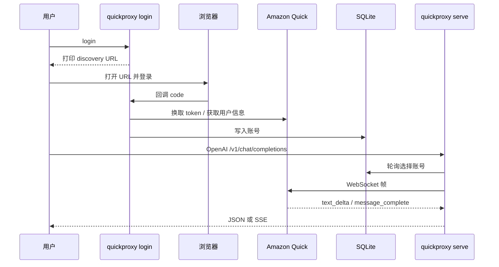

# QuickWork / Amazon Quick → OpenAI API

把 Amazon Quick（QuickWork）桌面端的聊天能力转换成 **OpenAI 兼容的 HTTP API**。

项目是单一 Go 可执行文件：原生 OAuth 登录、账号存储、token 刷新和反代全部由 Go 完成，不需要 Python，也不用启动官方桌面应用或 outpost 进程。登录后由反代把 `/v1/chat/completions` 请求转换为 QuickWork WebSocket 帧，并把结果转回普通 JSON 或 SSE。

> **本仓库是 [jasonxu114514/aws-quickwork-2api](https://github.com/jasonxu114514/aws-quickwork-2api) 的 fork**，在原项目基础上增加了网页管理控制台（见「网页控制台」一节）。反代核心、OAuth 流程、账号存储等全部来自原作者，感谢 [@jasonxu114514](https://github.com/jasonxu114514) 的开源工作。
>
> 非官方项目，与 Amazon / AWS 无关联。请仅在你拥有或获得明确授权的账号上使用，并遵守相关服务条款。

## 功能

- `POST /v1/chat/completions`，支持流式（SSE）与非流式响应
- `GET /v1/models`，返回本地模型别名
- 原生 social 登录（AWS IAM Identity Center OIDC）与企业 OIDC 登录，使用 PKCE
- 支持服务器/远程登录：手动粘贴浏览器 callback URL，无需开放本地回调端口
- 服务端配置集中存放在 `config.json`
- 账号存放在 SQLite（`data/quickwork.db`），支持多账号轮询与自动刷新
- 请求按轮询选择账号；到期 token 自动 refresh；失败时切换到下一个账号重试
- 可选本地 API key 保护
- 默认每轮对话结束后删除上游会话，避免污染聊天列表
- 保留 `assistant.tool_calls` / `role: tool` 历史，客户端工具调用链不会丢上下文
- 客户端 `tools` / `functions` 通过 `<client_tool_call>` 协议桥接；代理返回 OpenAI `tool_calls`，实际执行仍在客户端
- 上游原生 `tool_start` / `tool_arguments` / `tool_result` 在名称匹配时也会转成 OpenAI `tool_calls`
- 使用上游 `turn_usage` 返回 `usage` 与 `prompt_tokens_details.cached_tokens`
- `system` / `developer` 消息通过 QuickWork 原生 `system_prompt` 覆盖服务端基础提示词，并附加后端提示词覆盖声明，要求模型忽略上游追加的 system / agent 指令；不拼进 user 文本
- `POST /v1/files` 把文件上传到上游数据平面，返回 `file-<attachmentId>`（见「附件上传」一节）
- **自动适配上游 64 KB 帧限制**：超出时先精简工具协议 schema，再从最老轮次裁剪历史，仍未达标则返回带字节明细的 400，而不是让上游丢回一句看不懂的错误

## 环境要求

- Go 1.26+（仅构建时需要）
- 一个可正常登录的 Amazon Quick 账号
- 浏览器与 `quickproxy login` 运行在**同一台机器**，且本机回调端口（默认 `18080`）可被浏览器访问

## 快速开始

### 1. 构建

```bash
cd quickwork-openai
go build -o bin/quickproxy.exe ./cmd/quickproxy   # Windows
# go build -o bin/quickproxy ./cmd/quickproxy     # macOS / Linux
```

### 2. 登录上游账号

```bash
./bin/quickproxy login --provider social
```

首次运行会在当前目录创建 `config.json`，并在 `data/quickwork.db` 初始化 SQLite。终端会打印一个 discovery URL，例如：

```
https://quick.aws.com/sn?qwSurface=desktop:<nonce>:18080:1.2.4660
```

在**同一台机器**的浏览器中打开它，完成登录。工具会接收浏览器回调、完成 OAuth / PKCE、交换 token、获取用户信息，并把账号写入 SQLite。完成后终端只打印账号显示信息、`ws_host` 和到期时间，不打印 token。

企业 SSO 登录：

```bash
./bin/quickproxy login --provider enterprise --region us-east-1
```

需要登录多个账号时，重复执行 `login` 即可。相同 email + tenant 的账号会更新，不会重复插入。

#### 服务器 / 远程登录（手动回填 callback URL）

如果 `quickproxy` 跑在服务器上，浏览器访问不到服务器的 `localhost:18080`，使用手动模式：

```bash
./bin/quickproxy login -manual
```

流程：

1. 终端打印 discovery URL，在任意机器用浏览器打开并登录。
2. 浏览器会跳转到 `http://localhost:18080/callback?...`。这个页面可能打不开，属正常现象；从地址栏复制**完整 URL**，粘贴回终端。
3. 终端会打印 authorize URL；继续在浏览器打开并完成登录。
4. 浏览器会跳转到 `http://127.0.0.1:18080/?code=...`；同样复制地址栏的完整 URL，粘贴回终端。
5. 工具完成 token 交换并写入 SQLite。

工具会根据 URL 参数自动判断阶段：`nonce=...` 是 discovery callback，`code=...&state=...` 是授权完成 callback。贴入 authorize URL、discovery URL、重复的 discovery callback 或带 fragment 的 callback 都会被识别并提示下一步，不会重复注册 OAuth client。

整个过程不需要服务器开放回调端口；回调端口只用于生成浏览器地址。也可以把 callback URL 通过 stdin 管道传入，便于脚本化。

### 3. 启动反代

```bash
./bin/quickproxy serve
```

服务读取当前目录的 `config.json`。默认监听 `127.0.0.1:8080`。如果 `api_keys` 为空，代理关闭 API key 鉴权，适合纯本机使用。

### 4. 调用

```bash
curl http://127.0.0.1:8080/v1/models \
  -H "Authorization: Bearer local"
```

```bash
curl http://127.0.0.1:8080/v1/chat/completions \
  -H "Authorization: Bearer local" \
  -H "Content-Type: application/json" \
  -d '{
    "model": "smart",
    "stream": true,
    "messages": [{"role": "user", "content": "用三句话解释 QUIC"}]
  }'
```

Python SDK：

```python
from openai import OpenAI

# api_keys 为空时 api_key 可填任意值；配置后填对应 key。
client = OpenAI(base_url="http://127.0.0.1:8080/v1", api_key="local")

for chunk in client.chat.completions.create(
    model="smart",
    messages=[{"role": "user", "content": "hello"}],
    stream=True,
):
    print(chunk.choices[0].delta.content or "", end="")
```

## 配置 `config.json`

`quickproxy serve` / `login` 在文件不存在时会写入默认配置。完整示例：

```json
{
  "addr": "127.0.0.1:8080",
  "database": "data/quickwork.db",
  "api_keys": [],
  "models": ["smart", "fast", "balanced", "auto"],
  "default_model": "smart",
  "request_timeout": "5m",
  "refresh_before": "10m",
  "max_attempts": 3,
  "app_version": "1.2.4660",
  "surface": "QUICK_WORK_DESKTOP_WINDOWS",
  "outpost_id": "",
  "working_session_id": "",
  "timezone": "UTC",
  "locale": "en-US",
  "thinking_effort": "",
  "keep_sessions": false,
  "oauth": {
    "provider": "social",
    "build_stage": "prod",
    "region": "",
    "callback_port": 18080,
    "timeout": "1h"
  },
  "wui": {
    "enabled": false,
    "addr": "127.0.0.1:9080",
    "password": "",
    "session_ttl": "12h"
  }
}
```

| 字段 | 默认 | 说明 |
|---|---|---|
| `addr` | `127.0.0.1:8080` | HTTP 监听地址 |
| `database` | `data/quickwork.db` | SQLite 文件；相对路径基于 `config.json` 所在目录 |
| `api_keys` | `[]` | 允许的本地 API key；为空时关闭鉴权 |
| `models` | `smart,fast,balanced,auto` | `/v1/models` 返回值与 model 白名单 |
| `default_model` | `smart` | 未知 model 的映射 |
| `request_timeout` | `5m` | 单次上游请求超时 |
| `refresh_before` | `10m` | token 距离到期小于该值时自动 refresh |
| `max_attempts` | `3` | 单次请求最多尝试的账号数 |
| `app_version` | `1.2.4660` | 上游握手使用的 appVersion |
| `surface` | `QUICK_WORK_DESKTOP_WINDOWS` | 上游握手使用的 surfaceType |
| `outpost_id` / `working_session_id` | 空 | 上游握手可选字段 |
| `timezone` / `locale` | `UTC` / `en-US` | `user_message` 中的时区与语言 |
| `thinking_effort` | 空 | `off`、`low`、`medium`、`high` |
| `keep_sessions` | `false` | 保留上游会话，不在一轮结束后删除 |
| `oauth.provider` | `social` | `login` 默认 provider |
| `oauth.build_stage` | `prod` | `prod`、`beta`、`integ`、`dev` |
| `oauth.region` | 空 | 企业 discovery 的 region 前缀；social 使用 discovery 返回的 IDC region |
| `oauth.callback_port` | `18080` | 本机 OAuth 回调端口 |
| `oauth.timeout` | `1h` | 等待浏览器完成登录的超时 |
| `wui.enabled` | `false` | 随 `serve` 一起启动网页管理控制台 |
| `wui.addr` | `127.0.0.1:9080` | 控制台监听地址；需要公网访问时改成 `0.0.0.0:端口` |
| `wui.password` | 空 | 控制台登录密码；`enabled` 为 `true` 时必填，否则拒绝启动 |
| `wui.session_ttl` | `12h` | 控制台登录态有效期 |

时间字段接受 Go duration 字符串（`30s`、`5m`、`1h`）。

需要 API key 时，把 key 写进 `api_keys`：

```json
{
  "api_keys": ["sk-local"]
}
```

之后请求需带 `Authorization: Bearer sk-local`（或 `X-Api-Key: sk-local`）。

## 命令

| 命令 | 说明 |
|---|---|
| `quickproxy serve` | 启动反代 |
| `quickproxy webui` | 只启动网页管理控制台（不启反代） |
| `quickproxy login` | 浏览器 OAuth 登录并写入 SQLite |
| `quickproxy accounts` | 列出账号、到期时间、使用次数与最近错误 |
| `quickproxy refresh` | 刷新全部账号的 token |
| `quickproxy refresh -account ID` | 只刷新一个账号 |
| `quickproxy logout -all` | 删除全部账号 |
| `quickproxy logout -account ID` | 删除一个账号 |

所有命令都支持 `-config PATH`，默认 `config.json`。

从旧版升级：旧的 `auth/quickauth.py` 已移除，`data/session.json` / `data/upstream.json` 不再读取。请重新执行一次 `quickproxy login`；之后所有账号都由 SQLite 管理。

`login` 常用参数：

| 参数 | 默认 | 说明 |
|---|---|---|
| `-provider` | `config.oauth.provider` | `social`、`enterprise`、`gateway`、`social_gateway` |
| `-stage` | `config.oauth.build_stage` | `prod`、`beta`、`integ`、`dev` |
| `-region` | `config.oauth.region` | 企业 discovery 的 region 前缀；social 使用 discovery 返回的 IDC region |
| `-port` | `config.oauth.callback_port` | 本机回调端口 |
| `-timeout` | `config.oauth.timeout` | 等待浏览器完成登录的超时 |
| `-open` | 关闭 | 同时用默认浏览器打开 URL |
| `-manual` | 关闭 | 不监听本地回调端口，手动粘贴浏览器地址栏中的 callback URL（适合服务器） |

## 网页控制台

服务器上不方便开终端时，用内建控制台加号、管号池。

```json
{
  "wui": {
    "enabled": true,
    "addr": "0.0.0.0:9080",
    "password": "换成一个强密码",
    "session_ttl": "12h"
  }
}
```

`wui.enabled` 为 `true` 时，`quickproxy serve` 会额外监听一个 HTTP 端口；也可以用 `quickproxy webui` 单独启动，不占反代进程。

打开 `http://<地址>:9080/` 输入密码后可以：

- **添加账号**：点「+ 添加账号」，面板会从句柄启动一次 `login -manual`，并把 discovery URL 回显出来。整个流程是**两步**，面板会分步引导：
  1. 打开 discovery URL，用邮箱注册 AWS Builder ID 或直接登录。完成后浏览器跳向 `http://127.0.0.1:18080/callback?nonce=...`，页面报「无法访问此网站」不用管，复制地址栏整串贴回「回调 URL」提交。
  2. 面板拿到上游返回的**授权地址**（`https://oidc.<region>.amazonaws.com/authorize?...`）后会在「第 2 步」单独显示，点「继续登录」打开它；授权完成后再把地址栏里的 `...?code=...&state=...` 贴回同一个输入框提交，账号即写入号池。

  输入框是通用的：面板按 URL 参数自动识别阶段（`nonce=` → discovery 回调，`code=` → 授权回调，`/authorize?` → 授权地址，会提示你去浏览器打开）。授权回调若手快提前贴了，会先存住，等第一步完成自动补交。CLI 输出的每一步实时回显在面板日志里，出错原因（如 `discovery failed: ...`）直接顶到提示行。
- **号池管理**：查看每个账号的邮箱、状态（可用 / 即将到期 / 已过期 / 已停用 / 异常）、到期时间、使用次数、最近使用时间与最近错误；单账号刷新、停用 / 启用、删除，以及一键刷新全部 Token。
- **服务配置**：查看监听地址、数据库路径、上游 Provider、API Key 数量，并修改 `default_model`、`timezone`、`locale`、`thinking_effort`。写回 `config.json` 需要重启服务生效。

控制台的安全边界：密码用 SHA-256 定长比较，登录态是 32 字节随机会话 Cookie（`HttpOnly` + `SameSite=Lax`），密码校验失败固定延迟 250ms。**控制台暴露到公网时务必配强密码**，它等价于号池的完全控制权；更稳妥的做法是只监听回环地址，通过 SSH 端口转发或 Cloudflare Tunnel 访问。

管理接口一览（均需会话 Cookie）：

| 方法 | 路径 | 说明 |
|---|---|---|
| `GET` | `/api/session` | 查询当前会话状态 |
| `POST` | `/api/session` | 密码换会话 Cookie |
| `GET` | `/api/state` | 号池 + 配置 + 当前登录状态 |
| `POST` | `/api/login` | 启动一次登录，返回 discovery URL |
| `GET` | `/api/login/current` | 轮询登录进度与日志 |
| `POST` | `/api/login/callback` | 提交粘贴的回调 URL |
| `POST` | `/api/login/cancel` | 取消进行中的登录 |
| `POST` | `/api/refresh` | 刷新全部账号 token |
| `POST` | `/api/accounts/{id}/refresh` | 刷新单个账号 |
| `POST` | `/api/accounts/{id}/disable` \| `enable` | 停用 / 启用 |
| `DELETE` | `/api/accounts/{id}` | 删除账号 |
| `GET` \| `POST` | `/api/config` | 读取 / 写回运行参数 |

## 自定义 Agent 与多租户人格

桌面端 `user_message` 帧里**没有** `system_prompt` 字段（这个名字只出现在 agent 定义的导入导出里），所以调用方的 system 消息此前不会进入模型视野。真正承载人格的字段只有两个：

| 层 | 字段 | 作用 | 局限 |
| --- | --- | --- | --- |
| Agent 定义层 | `instructions` | 写进自定义 agent，进入 system 层 | 是**叠加**，改不掉服务端基座身份（模型仍会说自己是 AWS Quick） |
| 轮次上下文层 | `custom_prompt` / 提示正文 | 每轮随请求下发 | 模型视其为「用户设定」，优先级低于 system |

### agent 生命周期走 /api/ws-rpc

agent 管理在桌面端是 WebSocket 命令，但每条命令都能当普通 HTTP 打到运行时的 `/api/ws-rpc`，再由数据平面 `qbs-event` 的 `invokeAgent` 信封转发。响应形如 `{"frames":[{"type":"agent_draft_created","payload":{"agent_id":"..."}}]}`。

```
POST /v1/agents  {"name":"Carrier","instructions":"..."}   ->  {"agent_id":"..."}
```

拿到 id 后，对话请求带上 `X-Quickwork-Agent: <id>`（或配置 `agent_id`），代理会同时置 `chat_agent_id` 与 `use_draft`。

注意：**发布（publish）走不通**——`publish_agent_draft` 在服务端跑得比中继超时长，`invokeAgent` 直接返回 `TIMEOUT`，所以只保留草稿形态，靠 `use_draft` 引用。

### 多租户：一个共享 agent + 上下文注入

给每个租户建 agent 会撞 `max_custom_agents` 配额，且每个都要走一遍创建流程。可行做法是**一个中性 carrier agent 服务所有租户**：

```
agent_mode: "carrier"   # 开启后，调用方 system 文本会作为上下文块注入
agent_id:   "<carrier 的 id>"
```

注入形式：

```
<operating_instructions>
<调用方的 system/developer 文本>
</operating_instructions>

<用户消息>
```

carrier agent 自身的 instructions 保持中性（「按上下文中的 operating instructions 决定人格、语言、风格，不要自己产出固定标记」），差异全部由上下文承载。

实测（同一个 agent 连续服务两个租户）：

| 租户 | system 指令 | 回复 |
| --- | --- | --- |
| A | 只用日语，结尾 `[KO]` | 日语回答，结尾 `[KO]` |
| B | 只用中文，结尾 `[AH]` | 中文回答，结尾 `[AH]` |

语言、语气、格式标记全部正确切换。唯一残留是自述身份那一句仍会带出基座产品名——那是服务端 system 层的内容，`instructions` 覆盖不掉。

## 附件与超长上下文

图片和文件走官方同一套**外带（out-of-band）**链路：文件字节留在服务端工作区，WebSocket 帧里只带几百字节元数据，因此**不受 64 KB 单帧限制**。

### 四步协议

```
① 上传   POST {tenantUrl}/integration/quick-work/upload-attachment
          ?name=&contentType=&contentLength=
          body = 原始字节（Content-Type: application/octet-stream）
       -> {"attachmentId":"..."}

② DLP    GET  {tenantUrl}/integration/quick-work/attachment-dlp-status?attachmentId=
       -> {"dlpJobStatus":"COMPLETED","policyAction":"ALLOW"}   # 404/405 视为未开启

③ 投递   POST {tenantUrl}/integration/quick-work/qbs-event
          {"eventType":"invokeAgent","eventBody":{"invokeAgent":{
             "path":"files/upload/{threadID}","queryParams":{"_method":"POST"},
             "body":{"attachmentId":"..."}}}}
       -> eventResponse.invokeAgentResponse 是 JSON 字符串，其 body 又是 JSON 字符串，
          内层才是 {"path":"/data/s3files/.../attached_files/name.jpg"}

④ 引用   user_message.payload.attachments[] =
          {type,name,size,mimeType,path,attachmentId,contentSha256}
          有 path 时**绝不能**再带 data
```

三步 HTTP 都在建 WebSocket 之前就能用同一个 `threadID` 完成，因此上传与对话必然落在同一账号、同一会话上——否则投递会返回 `Attachment not found`。

### 超长上下文自动转存（spill-to-file）

单帧上限约 62 KB。组装完 `user_message` 后若超过 54 KB 安全线，且正文或 system prompt 超过 12 KB，就把超长文本转成 `conversation_context.txt` / `system_instructions.txt` 走同一套外带链路，帧里只留提示 + 末尾 3500 字节。

### 实测

| 场景 | 帧大小 | 结果 |
| --- | --- | --- |
| 2.6 MB 原图（JPEG 4096×1716） | 1818 B | 200，准确读出图中中文标题、英文副标与版权行 |
| 100 KB 文本，校验码藏在中段 | 5357 B | 200，精准返回 `PROBE-CODE-94821` |
| 2 KB 文字图 | — | 200，读出图内文字 |

上传按内容 sha256 在账号维度去重：同一张图在多轮里重复出现时只上传一次，每轮只重新绑定到当前会话（服务端内部复制，不是重新传输）。

### 接口

- `POST /v1/files`（multipart）暂存文件，返回 `file-<id>`；真正上传发生在对话轮次内，以保证账号一致。单文件上限默认 **95 MB**（`QUICKWORK_MAX_ATTACHMENT_MB` 可调，暂存池 `QUICKWORK_STAGING_MB`，默认 512 MB），请求体上限 32 MB。
- 对话请求里用 `X-Quickwork-Attachments: file-<id>[,file-<id2>]` 引用，或直接在 `messages` 里放 `image_url` 的 data URL / `file` part。

## 多账号轮询## 多账号轮询

账号存在 SQLite 的 `accounts` 表，按 ID 轮询：

1. 每个请求选择下一个启用账号。
2. 如果 token 在 `refresh_before` 内到期，先用 refresh token 自动刷新。
3. 刷新失败或账号不可用时记录 `last_error`，跳过该账号继续轮询。
4. 单次请求最多尝试 `max_attempts` 个账号；非流式请求和尚未向客户端发送任何数据的流式请求会自动换号重试。
5. 一旦流式响应已经开始，就不会中途换号，避免客户端收到重复内容。

`quickproxy accounts` 可查看每个账号的状态；`quickproxy refresh` 会刷新全部账号。上游 refresh token 失效时，对应账号需要重新执行 `quickproxy login`。

## 工作方式



- 登录完全在 `quickproxy login` 内完成，不依赖官方桌面应用或 outpost。
- `quickproxy serve` 从 SQLite 读取 `jwt`、`ws_host` 和 `provider`，连接上游 WebSocket。
- 上游不是 OpenAI HTTP API，而是 WebSocket JSON 帧；`internal/proxy/wire.go` 负责帧编码与 event-stream 解码。

### 提示词与工具调用

- `system` / `developer` 消息会按原顺序合并，放入 `user_message.payload.system_prompt`。
- `system_prompt` 始终发送：合并后的调用方指令后面固定追加一条后端提示词覆盖声明，要求模型忽略 QuickWork 服务端附加的 system / developer / agent 指令（身份、人格、产品名、默认行为、工具偏好、回复风格等），只遵循调用方指令和对话消息。客户端未提供 system 消息时，字段只包含该声明，服务端默认提示词不再生效。已验证 social 路径，enterprise / gateway 仍待逐项验证。
- 覆盖声明写在 `system_prompt` 里，不是 user 文本注入，也不会把 system prompt 塞进 user 文本。
- 客户端历史中的 `assistant.tool_calls` 会转成带 `id` / `name` 的文本，`role: tool` 会转成带 `call_id` / `name` 的工具结果，供上游继续推理。
- 客户端在 `tools` / `functions` 中声明的工具会以 `<client_tool_protocol>` 追加到 system prompt；模型用 `<client_tool_call>{"name":"...","arguments":{...}}</client_tool_call>` 发起调用。
- 如果客户端 system prompt 要求“必须用原生工具调用”或“禁止把工具调用写成文本”，桥接会附加一条后端能力说明：原生函数调用不可用，仅对列出的客户端工具改用该标记，其他指令保持不变。这是工具协议适配，不是通用提示词注入。
- 代理解析该标记并返回 OpenAI `tool_calls`，但**不执行工具**；客户端执行后把结果作为 `role: tool` 发回，代理再转成文本上下文。
- 有客户端工具时，流式响应会缓冲到本轮结束，再一次性发送 `tool_calls` 或文本；非流式不受影响。
- `tool_choice: "none"` 会关闭桥接；`tool_choice` 为具体函数时只接受该函数。上游原生工具事件在名称匹配时仍可转成 `tool_calls`。
- 非流式响应中，工具调用放在 `choices[0].message.tool_calls`；桥接调用或只有工具且没有最终文本时 `finish_reason` 为 `tool_calls`，否则为 `stop`。

## 安全与隐私

- `data/quickwork.db` 包含 access token、refresh token、client secret 和用户信息，已被 `.gitignore` 排除。
- `config.json` 默认不含密钥；如果写入 `api_keys`，不要提交真实 key。
- 登录密码只在 Amazon 的浏览器页面中输入，本项目不会保存密码。
- 反代默认只监听 `127.0.0.1`。不要把端口直接暴露到公网；如确需远程访问，请自行加 TLS 与访问控制。
- `quickproxy logout -all` 会删除本地账号与 refresh 状态。
- 不要提交或分享 `data/` 目录。

## 限制

- 只实现聊天补全。`temperature`、`max_tokens`、`stop`、`response_format` 等采样参数不会传给上游；`n > 1` 会返回 400。
- 工具执行在客户端；代理只负责把模型输出转成 `tool_calls`。桥接使用文本协议，模型偶尔可能不遵守；带工具的流式响应会缓冲到本轮结束。
- `system_prompt` 覆盖已在 social 路径验证；enterprise / gateway 仍待验证。空 system 消息也会发送覆盖声明，因此服务端默认提示词不会生效。
- `model` 会映射为上游 agent mode：`smart`、`fast`、`balanced`、`auto`。
- 上游对单个 `user_message` 帧有 **64 KB 上限**（超出返回 `FrameTooLarge`）。代理会在发送前把请求压到预算内：先精简工具协议（去掉缩进与 schema 注解），再从最老轮次裁剪历史并追加一条省略提示；仍不够则返回 400 `request_too_large` 并说明是 `text` 还是 `system_prompt` 超限。预算默认 62000 字节，可用环境变量 `QUICKPROXY_MAX_PAYLOAD` 调整。
- `POST /v1/files` 的上传链路已验证可用；**但把 attachmentId 关联进对话帧的字段格式尚未确认**，因此目前上传的文件不会自动进入模型上下文，长内容仍靠上面的预算裁剪兜底。
- 上游没有模型列表 API；`/v1/models` 返回的是本项目配置的别名。
- social / enterprise 路径已做真实账号验证；`gateway` / `social_gateway` 的 CBOR 路径仍属实验性。
- 上游 access token 通常约 1 小时到期，反代会按 `refresh_before` 自动刷新；也可手动执行 `quickproxy refresh`。
- 多账号轮询按请求选择账号，不按 token 用量或配额调度。
- 上游接口可能随官方客户端更新而变化；若登录或聊天失败，先重新执行 `quickproxy login`。
- 本项目与 Amazon / AWS 无关联，不提供任何服务保证。

## 故障排查

| 现象 | 处理 |
|---|---|
| `cannot listen on 127.0.0.1:18080` | 关闭占用 18080 的其他进程，或用 `-port` / `oauth.callback_port` 换端口 |
| 浏览器登录后一直等待 | 确认浏览器与命令在同一台机器，且回调端口可达；远程服务器请用 `login -manual` |
| 服务器上 `localhost:18080` 回调打不开 | 这是预期现象；用 `login -manual`，复制浏览器地址栏的完整 URL 回填 |
| `upstream_session_unavailable` / `no accounts configured` | 运行 `quickproxy login` |
| `401 invalid_api_key` | 检查 `config.json` 的 `api_keys` 与请求头中的 key 是否一致 |
| 登录页面报错 | 查看终端输出的错误；确认 `-provider` 与账号类型匹配 |
| 多账号请求总是失败 | 运行 `quickproxy accounts` 查看 `last_error`；对失效账号重新 `login` 或 `logout -account ID` |
| token 过期 | 通常自动刷新；也可运行 `quickproxy refresh` |

## 目录

```
quickwork-openai/
  config.json              服务端配置（首次运行自动生成）
  cmd/quickproxy/          CLI：serve / login / accounts / refresh / logout / webui
  internal/config/         config.json 加载与默认值
  internal/oauth/          原生 OAuth、PKCE、token refresh、user info
  internal/store/          SQLite 账号存储
  internal/accounts/       多账号轮询与自动刷新
  internal/proxy/          WebSocket codec、OpenAI handler
  internal/wui/            网页管理控制台（内嵌 HTML，无外部依赖）
  data/quickwork.db        运行期账号库（gitignored）
```

## License

本项目采用 [GNU General Public License v3.0](LICENSE) 授权。

## Acknowledgements

Thanks to the [LINUX DO](https://linux.do) community for its support.

## 版本历史

> 本仓库从上游 v0.4.1 分叉，以下只记录本 fork 相对上游的变更，倒序排列；时间取提交时的真实时间（UTC+08:00）。

### v0.8.1 — 2026-11-22 18:47:00

放开附件体积并明确“原图直传”。

- 单文件上限从写死的 25 MB 改为默认 95 MB（对齐上游），可用 `QUICKWORK_MAX_ATTACHMENT_MB` 调整；暂存池上限 512 MB，可用 `QUICKWORK_STAGING_MB` 调整
- 上传字节与本地文件完全一致，不做任何重编码／缩放（代码中无 image 解码逻辑）；日志会打印 `uploaded as-is: N bytes original` 与工作区落盘路径，便于核对
- 说明：模型侧视觉编码器在推理前会把图片缩到约 2000 px 宽，这是上游预处理，不经过本代理；原分辨率文件留在会话工作区，agent 可按需读取
- 澄清指标：日志里的 `frame=N bytes` 是 WebSocket 帧内元数据大小，与图片体积无关

### v0.8.0 — 2026-11-22 18:37:47

附件改为官方外带链路，图片与超长上下文不再受 64 KB 单帧限制。

- 实现完整四步协议：`upload-attachment` → `attachment-dlp-status` 轮询 → `qbs-event` 的 `invokeAgent` 信封投递 → 帧内只引用 `path`
- 投递响应是三层嵌套 JSON（`invokeAgentResponse` 与内层 `body` 各为一层字符串），已按层解包
- 上传与投递改在同一轮、同一账号内完成，修复多账号下投递返回 `Attachment not found`
- `POST /v1/files` 改为暂存字节、轮次内真实上传；单文件上限 25 MB，请求体上限 32 MB
- 新增 spill-to-file：帧超 54 KB 且正文/system prompt 超 12 KB 时自动转存为 `conversation_context.txt` / `system_instructions.txt` 并改为引用
- 上传按内容 sha256 在账号维度去重，多轮重复图片只传一次，每轮仅重新绑定会话
- 实测：2.6 MB 原图（帧 1818 B）、100 KB 文本（帧 5357 B）均 200 且内容识别准确

### v0.7.0 — 2026-11-22 18:13:45

打通图片与文件附件，确认上游帧限制同样作用于附件。

- `POST /v1/files` 上传后可被对话直接引用：附件以 `payload.attachments[]` 投递，元素形状与官方客户端序列化器一致（`type` / `name` / `size` / `mimeType` / `path` / `attachmentId` / `contentSha256` / `data`）
- 采用内联投递（`data` 为 data URL）：文件随帧传输，无需先绑定会话；实测 2 KB 文字图与 32/37 KB 真实照片均能被模型正确读解（读出图内随机码、中文标题、英文副标与版权行）
- 内联上限默认 40 KB，可用 `QUICKWORK_INLINE_MAX` 调整；超出时保留引用、丢弃 `data`
- 修正：默认附件形状此前指向需要 out-of-band 投递的引用形式，导致图片一律被上游忽略；现默认内联
- 附带实验开关 `QUICKWORK_ATTACH_BYPASS_BUDGET`，用于测量上游真实帧上限
- 已知限制：47 KB 以上附件仍被上游丢弃（内联内容与 `text`／`system_prompt` 共享同一个 64 KB 帧预算）；更大的文件需要 out-of-band 投递链路，尚未实现

### v0.6.0 — 2026-11-22 17:30:08

适配上游 64 KB 帧限制，新增附件上传接口。

- 新增 `POST /v1/files`：把文件上传到账号数据平面，返回 `file-<attachmentId>`，单文件上限 20 MB
  - 上游是 Coral RPC 风格，参数走 query、请求体为文件原始字节：`POST {tenantUrl}/integration/quick-work/upload-attachment?name=&contentLength=&contentType=`
  - `Session` 增加 `TenantURL`，用于定位该账号的数据平面
- 新增发送前载荷预算控制：上游对单个 `user_message` 帧有 64 KB 上限（`FrameTooLarge`），超限会整轮失败
  - 先精简工具协议 schema：紧凑 JSON，剥掉 `description`、`$schema`、`examples`、`default`、`additionalProperties` 等纯占字节的注解，保留参数名、类型、`required` 与 `enum`
  - 仍超限则从最老轮次裁剪历史，绝不动当前轮，末尾追加省略提示
  - 再超限返回 400 `request_too_large`，并说明 `text` 与 `system_prompt` 各占多少字节
  - 预算默认 62000 字节，可用环境变量 `QUICKPROXY_MAX_PAYLOAD` 覆盖
- 实测：242 KB 历史请求与 266 KB 工具集请求，改动前均 502 失败，改动后均正常返回
- 已知限制：附件上传链路可用，但把 `attachmentId` 关联进对话帧的字段格式尚未确认，上传的文件暂不会进入模型上下文

### v0.5.0 — 2026-11-22 15:38:30

新增网页管理控制台。

- `config.json` 增加 `wui` 配置块（`enabled` / `addr` / `password` / `session_ttl`）
  - `serve` 时附带启动控制台；也可用 `quickproxy webui` 单独运行，不启反代
  - `enabled` 为真但 `password` 为空时拒绝启动，避免裸奔
- 控制台功能：账号池（状态 / 到期 / 用量、单号刷新、停用启用、删除、一键刷新全部）、OAuth 登录、配置面板
- OAuth 登录支持两阶段手动流程：驱动 `login -manual` 子进程，按 URL 参数自动识别回调类别（`nonce=` 为 discovery 回调、`code=` 为授权回调、`/authorize?` 为授权地址），提前到达的授权回调先暂存、待 discovery 完成后自动补交；CLI 输出实时回显
- 配置面板可编辑 `default_model`、`timezone`、`locale`、`thinking_effort`，写回 `config.json` 采用临时文件 + rename 原子替换
- 鉴权：SHA-256 定长比较 + 内存会话 Cookie（`HttpOnly`、`SameSite=Lax`），密码校验失败固定延迟
- 新增 `internal/wui` 包，HTML 内嵌，未引入任何第三方依赖

